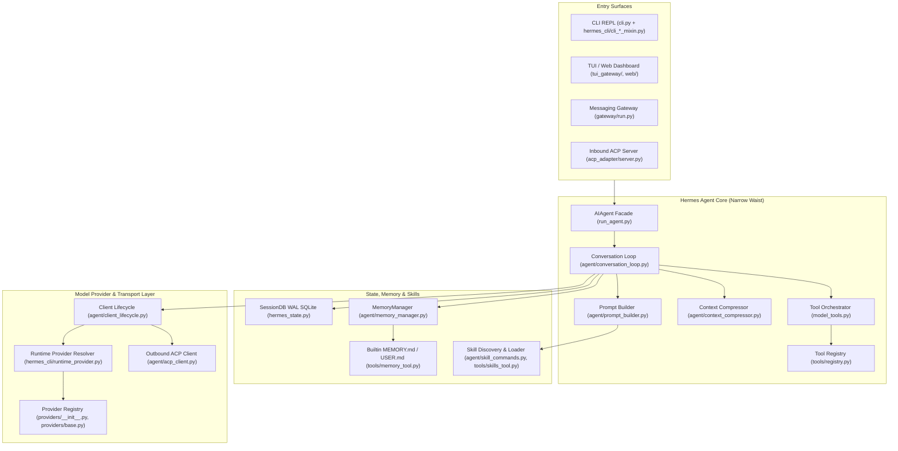

# 01 — Hermes Agent Architecture Analysis

**Project:** APA (Antigravity Personal Agent) — Phase 1 Audit  
**Repository:** `C:\Users\firdaus\APA` (`apa-development`)  
**Target Platform:** Windows / PowerShell

---

## 1. Executive Architectural Overview

Hermes Agent is a personal AI agent engine structured around a **narrow core waist** (`AIAgent` turn loop + tool registry + SQLite state) and **pluggable edges** (model providers, memory providers, context engines, skills, CLI commands, and 25+ gateway platform adapters).

Two architectural invariants govern every subsystem ([AGENTS.md](file:///C:/Users/firdaus/APA/AGENTS.md#L18-L27)):
1. **Per-conversation prompt caching is sacred:** The system prompt and `tools[]` schema array are built once at session initialization and held byte-identical across turns. Mid-conversation context updates are injected into user messages or tool results; only context compression rebuilds the prefix.
2. **Facade + siblings module layout:** Former monolithic files act as thin public facades (`run_agent.py`, `hermes_state.py`, `cli.py`, `gateway/run.py`, `hermes_cli/plugins.py`, `tools/approval.py`) backed by topic-scoped sibling modules (`<stem>_<topic>.py`) that late-import the facade inside functions to prevent circular imports.



---

## 2. Agent Core (`run_agent.py` & `agent/`)

| Component | File & Lines | Primary Classes / Functions | Responsibility | Dependencies |
|---|---|---|---|---|
| Agent Facade | [run_agent.py](file:///C:/Users/firdaus/APA/run_agent.py#L1-L180) | `AIAgent` | Public entry point composing 14 mixins (`ClientLifecycleMixin`, `StreamDeliveryMixin`, `TurnFacadeMixin`, `SessionPersistenceMixin`, `CompressionFacadeMixin`, etc.). | `agent/*`, `model_tools`, `hermes_state` |
| Initialization | [agent/agent_init.py](file:///C:/Users/firdaus/APA/agent/agent_init.py#L1-L120) | `init_agent()` | Resolves provider/model config, initializes `IterationBudget`, `MemoryManager`, `ContextCompressor`, and `SessionDB`. | `hermes_cli.runtime_provider`, `hermes_constants` |
| Turn Loop | [agent/conversation_loop.py](file:///C:/Users/firdaus/APA/agent/conversation_loop.py#L1-L120) | `run_conversation_loop()` | Drives multi-turn LLM execution: pre-turn memory prefetch, prompt assembly, API call (`_send_api_request`), streaming, tool batch dispatch, post-turn persistence. | `agent/turn_*.py`, `agent/execution_step.py` |
| Prompt Assembly | [agent/prompt_builder.py](file:///C:/Users/firdaus/APA/agent/prompt_builder.py#L1-L120) | `build_system_prompt()`, `build_skills_index()` | Constructs and caches the session system prompt from persona (`SOUL.md`), context files (`AGENTS.md`, `.cursorrules`), memory snapshot, and skill index. | `agent/prompt_caching.py`, `agent/memory_manager.py` |
| Context Management | [agent/context_compressor.py](file:///C:/Users/firdaus/APA/agent/context_compressor.py#L1-L120) | `ContextCompressor` | Pluggable `ContextEngine` ABC; monitors token usage and summarizes history at threshold (`compression.threshold`, default `0.50`), splitting session lineage via `parent_session_id`. | `agent/context_engine.py`, `hermes_state_compression.py` |
| Turn Helpers | [agent/turn_execution.py](file:///C:/Users/firdaus/APA/agent/turn_execution.py), [agent/turn_Prep.py](file:///C:/Users/firdaus/APA/agent/turn_prep.py), [agent/turn_tail.py](file:///C:/Users/firdaus/APA/agent/turn_tail.py) | `execute_tool_calls_batch()`, `_prepare_turn()` | Parallel tool execution (`_MAX_TOOL_WORKERS = 8`), tool guardrail evaluation, and turn finalization. | `model_tools.py`, `agent/tool_guardrails.py` |

---

## 3. Memory & State Architecture (`hermes_state.py` & `agent/memory_manager.py`)

| Subsystem | File & Lines | Classes / Functions | Storage & Mechanism |
|---|---|---|---|
| Session State DB | [hermes_state.py](file:///C:/Users/firdaus/APA/hermes_state.py#L1-L160) + 24 `hermes_state_*.py` siblings | `SessionDB` (`SessionSchemaMixin`, `SessionMessagesMixin`, `SessionSearchMixin`, `SessionWalMixin`) | SQLite database at `get_hermes_home() / "state.db"` in WAL mode (`hermes_state_wal.py`). Stores `sessions`, `messages`, and `messages_fts` (FTS5 virtual table for cross-session `session_search`). Enforces single-writer mutex (`hermes_state_write.py`) and read pool (`hermes_state_readpool.py`). |
| Memory Orchestrator | [agent/memory_manager.py](file:///C:/Users/firdaus/APA/agent/memory_manager.py#L1-L160) | `MemoryManager`, `_StuckCallGate`, `_redact_for_provider()` | Fans out lifecycle hooks (`on_session_start`, `queue_prefetch`, `sync_turn`, `on_pre_compress`, `on_session_end`) to the built-in memory provider plus at most **one** external plugin `MemoryProvider` (`plugins/memory/*`). Scrubs all egress via `redact_for_egress()`. |
| Builtin File Memory | [tools/memory_tool.py](file:///C:/Users/firdaus/APA/tools/memory_tool.py) | `MemoryStore`, `memory_tool()` | Curated bounded markdown files at `get_hermes_home() / "memories" / "MEMORY.md"` (2,200 char cap) and `"USER.md"` (1,375 char cap). Injected as a frozen snapshot into the system prompt at session start to preserve prompt cache. |
| Pluggable Memory Providers | `plugins/memory/` (`honcho`, `mem0`, `supermemory`, `holographic`, `retaindb`, `openviking`, `SimpleMem`) | `MemoryProvider` subclass ([agent/memory_provider.py](file:///C:/Users/firdaus/APA/agent/memory_provider.py)) | External vector/graph/SQLite memory engines registered via `MemoryManager.add_provider()`. |

---

## 4. Skills System (`skills/` & `agent/skill_commands.py`)

| Phase | File & References | Implementation Details |
|---|---|---|
| Discovery | [agent/prompt_builder.py](file:///C:/Users/firdaus/APA/agent/prompt_builder.py), [agent/skill_utils.py](file:///C:/Users/firdaus/APA/agent/skill_utils.py) | Scans `$HERMES_HOME/skills/` (bundled + user-installed) and external `skills.external_dirs`. Filters by `platforms:` frontmatter (`macos`, `linux`, `windows`) and `metadata.hermes.fallback_for_toolsets`. |
| Progressive Disclosure | [tools/skills_tool.py](file:///C:/Users/firdaus/APA/tools/skills_tool.py) | Only a compact `<available_skills>` index (name + short description) goes into the system prompt. Calling `skills_list`, `skill_view(name)`, or `/<skill-name>` loads full `SKILL.md` and `references/` on demand. |
| Creation & Curation | [tools/skill_manager_tool.py](file:///C:/Users/firdaus/APA/tools/skill_manager_tool.py), [agent/curator.py](file:///C:/Users/firdaus/APA/agent/curator.py) | `skill_manage` tool supports `create`, `edit`, `patch`, `delete` of procedural skills; `tools/skills_hub.py` and `tools/skills_sync.py` manage registry installation and manifest sync. |

---

## 5. Tool Execution Architecture (`model_tools.py`, `tools/registry.py`, `toolsets.py`)

```mermaid
sequenceDiagram
    participant Loop as agent/conversation_loop.py
    participant MT as model_tools.py::handle_function_call
    participant Guard as _pre_dispatch_guards (plugins + ACP edit)
    participant Reg as tools/registry.py::ToolRegistry
    participant App as tools/approval.py
    participant Handler as tools/*_tool.py

    Loop->>MT: handle_function_call(name, args, ids)
    MT->>MT: coerce_tool_args() + hosted_tool_refusal()
    MT->>MT: _dispatch_bridge_tool() (if tool_search/tool_call)
    MT->>MT: _apply_request_middleware()
    MT->>Guard: _dispatch_pre_tool_call_hooks() + maybe_require_edit_approval()
    alt Blocked by plugin pre_tool_call
        Guard-->>MT: ("plugin_block", tool_error)
        MT-->>Loop: JSON error + post_tool_call(status="blocked")
    else Allowed
        MT->>Reg: registry.dispatch(name, args)
        Reg->>Handler: execute handler
        Handler->>App: check_all_command_guards() / file_safety
        Handler-->>Reg: JSON string result
        Reg-->>MT: bounded JSON result (_MAX_TOOL_ERROR_CHARS=2048)
        MT->>MT: _emit_post_tool_call_hook() + _apply_transform_tool_result_hook()
        MT-->>Loop: Final tool result string
    end
```

- **Registration ([tools/registry.py](file:///C:/Users/firdaus/APA/tools/registry.py#L121-L176)):** `discover_builtin_tools()` AST-scans `tools/*.py` and `tools/*/tool.py` (memoized by `(mtime_ns, size)` on disk) and imports modules calling `registry.register(name, toolset, schema, handler, check_fn, is_async, emoji)`.
- **Toolsets ([toolsets.py](file:///C:/Users/firdaus/APA/toolsets.py)):** Resolves composite toolset profiles (`hermes-cli`, `hermes-gateway`, `hermes-acp`) and applies `disabled_toolsets` subtraction last ([model_tools.py](file:///C:/Users/firdaus/APA/model_tools.py#L351-L357)).
- **Dynamic Schema Rewriting & Tool Search ([model_tools.py](file:///C:/Users/firdaus/APA/model_tools.py#L489-L550)):** Rewrites schemas based on active sibling tools (`_DYNAMIC_SCHEMA_REWRITERS`) and collapses large MCP/plugin tool catalogs behind `tool_search` / `tool_describe` / `tool_call` when context share is exceeded.
- **Async Bridging ([model_tools.py](file:///C:/Users/firdaus/APA/model_tools.py#L71-L148)):** Maintains a persistent main-thread event loop (`_get_tool_loop`) and per-worker-thread loops (`_get_worker_loop`) with `propagate_context_to_thread` so `ContextVar` scopes (profile home, approval context) survive thread hops.

---

## 6. Other Core Subsystems & Entry Points

| Subsystem | Key Files | Architecture & Role |
|---|---|---|
| CLI & Mixins | [cli.py](file:///C:/Users/firdaus/APA/cli.py), [hermes_cli/main.py](file:///C:/Users/firdaus/APA/hermes_cli/main.py), `hermes_cli/cli_*_mixin.py` | Interactive `prompt_toolkit` REPL (`HermesCLI`), slash command dispatch (`hermes_cli/commands.py`), profile multiplex (`hermes_cli/profiles.py`), and subcommand CLI (`hermes chat`, `hermes model`, `hermes auth`, `hermes gateway`, `hermes acp`). |
| Messaging Gateway | [gateway/run.py](file:///C:/Users/firdaus/APA/gateway/run.py) + `gateway/run_*.py`, `gateway/platforms/*.py` | Multi-platform async daemon serving 25+ messaging adapters (Telegram, Discord, Slack, WhatsApp, etc.). Explicitly binds profile scopes (`bind_profile_scope`) across every async/thread boundary. |
| Background Tasks | [tools/process_registry.py](file:///C:/Users/firdaus/APA/tools/process_registry.py), [tools/terminal_tool.py](file:///C:/Users/firdaus/APA/tools/terminal_tool.py) | Manages background processes (`background=True`, `pty=True`) with `process` tool actions (`list`, `poll`, `wait`, `kill`, `submit`) and output ring buffers. |
| Multi-Agent Delegation | [tools/delegate_tool.py](file:///C:/Users/firdaus/APA/tools/delegate_tool.py), [agent/delegation_context.py](file:///C:/Users/firdaus/APA/agent/delegation_context.py) | Spawns isolated child `AIAgent` instances (`delegate_task`) with restricted toolsets (strips `delegate_task`, `clarify`, `memory`, `cronjob`), separate `IterationBudget`, and propagated cancel/interrupt signals. |
| Cron & Kanban | [cron/scheduler.py](file:///C:/Users/firdaus/APA/cron/scheduler.py), [hermes_cli/kanban.py](file:///C:/Users/firdaus/APA/hermes_cli/kanban.py) | Tick-driven background job scheduler (`cron/jobs.py`) and SQLite-backed Kanban worker dispatcher (`hermes_cli/kanban_dispatcher.py`). |
| Browser Automation | [tools/browser_tool.py](file:///C:/Users/firdaus/APA/tools/browser_tool.py), [tools/browser_cdp.py](file:///C:/Users/firdaus/APA/tools/browser_cdp.py) | Local Chromium/Chrome CDP automation (`browser_Use`, `browser_cdp`, `browser_exec`, `browser_vault`) with session lifecycle cleanup (`tools/browser_session_lifecycle.py`). |

---

## 7. Architectural Risks & Recommendations for APA

| Finding | Risk Level | Recommendation |
|---|---|---|
| Prompt Cache Invariant (`tests/ci/test_prompt_surface.py`) | **High** (if violated) | Do **not** alter Hermes's stock system prompt or core `tools[]` list. Inject APA-specific system prompt rules via `PluginContext.register_system_prompt_section()` or `.hermes/AGENTS.md`. |
| Core/Plugin Boundary Lint (`scripts/boundary_lint.py`) | **Medium** | Core modules must never import bundled plugins. Implement APA's Antigravity provider and Security Guard as self-contained plugins (`plugins/model-providers/antigravity/` and `~/.hermes/plugins/apa-security/`). |
| Multi-Profile Process Scope (`HX001`–`HX012`) | **Medium** | Always resolve state paths through `get_hermes_home()` (`hermes_constants.py`) rather than hardcoding `~/.hermes` or reading unbound `os.environ`. |
