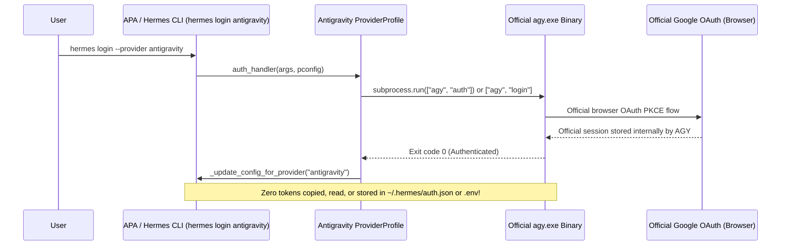

# 03 — Authentication Architecture Analysis

**Project:** APA (Antigravity Personal Agent) — Phase 1 Audit  
**Repository:** `C:\Users\firdaus\APA` (`apa-development`)  
**Target Auth Flow:** `APA → AGY (agy.exe) → Official Google OAuth → Antigravity`

---

## 1. Hermes Authentication Architecture

Hermes centralizes provider authentication and credential resolution in [hermes_cli/auth.py](file:///C:/Users/firdaus/APA/hermes_cli/auth.py) and its sibling modules (`hermes_cli/auth_*.py`), bridged to `ProviderProfile` declarations in [providers/base.py](file:///C:/Users/firdaus/APA/providers/base.py).

| Component | File & Lines | Responsibility |
|---|---|---|
| Auth Registry & CLI | [hermes_cli/auth.py](file:///C:/Users/firdaus/APA/hermes_cli/auth.py#L1-L450) | Defines `ProviderConfig`, `PROVIDER_REGISTRY`, `HomeScopedRegistry`, `auth_command` (`hermes login`, `hermes logout`, `hermes auth status`), and `~/.hermes/auth.json` read/write helpers. |
| Plugin Auth Bridge | [hermes_cli/auth_plugin_providers.py](file:///C:/Users/firdaus/APA/hermes_cli/auth_plugin_providers.py) | Automatically registers `ProviderProfile` plugins into `PROVIDER_REGISTRY` and dispatches custom `profile.auth_handler(args, pconfig)` and `profile.status_checker()`. |
| External Process Auth | [hermes_cli/auth.py](file:///C:/Users/firdaus/APA/hermes_cli/auth.py#L1614-L1646), [hermes_cli/runtime_provider_backends.py](file:///C:/Users/firdaus/APA/hermes_cli/runtime_provider_backends.py#L225-L263) | Resolves `auth_type="external_process"` providers by locating the external CLI executable (`shutil.which` or `binary_env`) without storing or extracting tokens. |
| Credential Pool | [agent/credential_pool.py](file:///C:/Users/firdaus/APA/agent/credential_pool.py), [agent/client_lifecycle.py](file:///C:/Users/firdaus/APA/agent/client_lifecycle.py#L200-L340) | Manages multi-key round-robin/failover (`CredentialPool`), runtime leases, and cooldown marking on 401/429 errors. |
| Secret Scope & Env | [hermes_cli/env_loader.py](file:///C:/Users/firdaus/APA/hermes_cli/env_loader.py), [agent/secret_scope.py](file:///C:/Users/firdaus/APA/agent/secret_scope.py) | Loads `get_hermes_home() / ".env"` into profile-isolated `ContextVar` secret scopes so concurrent profiles in one gateway process never leak credentials via `os.environ`. |

---

## 2. Authentication Mechanisms & Lifecycle

### 2.1 Supported `auth_type` Modes ([providers/base.py](file:///C:/Users/firdaus/APA/providers/base.py#L121-L130))
1. **`api_key` (Default):** Reads API keys from `ProviderProfile.api_key_env_vars` (in `.env` or environment) or `auth.json`.
2. **`oauth_device_code` / `oauth_pkce` / `oauth_external`:** Used by Nous Portal (`_login_nous`), OpenAI Codex (`_login_openai_codex`), GitHub Copilot (`hermes_cli/copilot_auth.py`), and Anthropic OAuth.
3. **`external_process`:** Designed specifically for CLI-backed agents where an external binary owns its own authentication lifecycle. Hermes stores only `"active_provider": "<id>"` in `auth.json` and delegates auth entirely to the external binary.

### 2.2 Credential Storage & File Permissions
- **`auth.json` Store:** Located at `get_hermes_home() / "auth.json"`, protected by cross-process file locks (`_auth_store_lock()` in [hermes_cli/auth.py](file:///C:/Users/firdaus/APA/hermes_cli/auth.py#L110-L150)) and owner-only ACLs ([hermes_dir_acl.py](file:///C:/Users/firdaus/APA/hermes_dir_acl.py)).
- **`.env` Store:** Located at `get_hermes_home() / ".env"`, guarded against model file-read/write tools by [agent/file_safety.py](file:///C:/Users/firdaus/APA/agent/file_safety.py#L50-L71) and scrubbed from terminal subprocess environments by [tools/environments/local_env_policy.py](file:///C:/Users/firdaus/APA/tools/environments/local_env_policy.py).

### 2.3 Token Refresh, Expiration, and Logout
- **Token Refresh:** `ProviderProfile.refresh_credential(creds: dict) -> Optional[dict]` ([providers/base.py](file:///C:/Users/firdaus/APA/providers/base.py#L220-L230)) is invoked automatically when a pooled OAuth credential approaches expiration (`expires_at`) or receives HTTP 401.
- **Logout (`hermes logout`):** `_logout_provider()` clears the provider's state in `auth.json` (or invokes custom `logout_fn`) and resets `active_provider`.

---

## 3. Integrating Official Antigravity Authentication (`APA → AGY → Google OAuth`)

### 3.1 How AGY Manages Official Google OAuth
Inspection of the installed `agy.exe` (`v1.5.9` at `C:\Users\firdaus\AppData\Local\agy\bin\agy.exe`) confirms:
- `agy login` and `agy acp --login` trigger the **official Google OAuth browser flow** managed internally by `agy.exe`.
- `agy logout` revokes and clears the official session via `agy.exe`.
- `agy auth` (and `agy models`) verifies authentication status through `agy.exe` without exposing raw OAuth tokens.

### 3.2 Zero-Trust Delegation Pattern in Hermes
By registering the Antigravity provider profile with `auth_type="external_process"`:

| Auth Lifecycle Step | APA / Hermes Implementation via `ProviderProfile` | Touches Raw Google Tokens? |
|---|---|---|
| **Binary Discovery** | `resolve_external_process_provider_credentials("antigravity")` checks `HERMES_ANTIGRAVITY_BIN`, `shutil.which("agy")`, and `%LOCALAPPDATA%\agy\bin\agy.exe`. | **No** |
| **Auth Status Check (`setup_status` / `status_checker`)** | Runs `agy auth` (or checks ACP `initialize` / `agy models` exit code) with a bounded timeout. | **No** |
| **Interactive Login (`auth_handler`)** | Invokes `subprocess.run([agy_bin, "login"])` (or `[agy_bin, "acp", "--login"]`) attached to the user's terminal TTY. | **No** |
| **Token Refresh** | Handled transparently inside `agy.exe` during ACP / CLI execution. | **No** |
| **Logout** | Invokes `subprocess.run([agy_bin, "logout"])` and clears `active_provider` in `auth.json`. | **No** |

---

## 4. Security & Compliance Findings

1. **Strict Credential Isolation:** Neither Hermes nor APA ever reads `~/.gemini` token databases, SQLite files, or Windows Credential Manager entries belonging to `agy.exe`.
2. **Subprocess Environment Hygiene:** Because `auth_type="external_process"` uses `api_key="acp-stdio"` (a non-secret placeholder in [hermes_cli/runtime_provider_backends.py](file:///C:/Users/firdaus/APA/hermes_cli/runtime_provider_backends.py#L254)), no OAuth bearer token is ever placed into Python strings, `os.environ`, or `state.db`.
3. **Actionable Auth Recovery:** If `agy.exe` returns an authentication error (`AcpAuthRequiredError` / code `-32001` or `401`), `ProviderProfile.classify_api_error()` maps it to `FailoverReason.auth` with the message: *"Antigravity authentication required. Run `agy login` or `hermes login --provider antigravity`."*
