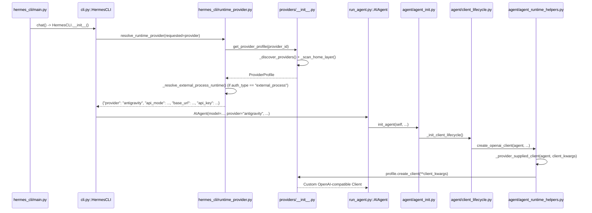

# 08 — Reverse Engineering Report: Execution Flows & Call Traces

**Project:** APA (Antigravity Personal Agent) — Phase 1 Audit  
**Repository:** `C:\Users\firdaus\APA` (`apa-development`)

---

## 1. End-to-End Call Trace: CLI Startup to Provider Client Creation



### Verified Source References
1. **Entry & Bootstrap:** [hermes_cli/main.py](file:///C:/Users/firdaus/APA/hermes_cli/main.py) imports `hermes_bootstrap` (UTF-8 stdio setup on Windows), parses CLI flags, and launches `HermesCLI` in [cli.py](file:///C:/Users/firdaus/APA/cli.py).
2. **Runtime Provider Resolution:** `resolve_runtime_provider()` ([hermes_cli/runtime_provider.py](file:///C:/Users/firdaus/APA/hermes_cli/runtime_provider.py#L1168-L1305)) walks `_ladder_rungs()`. When the provider has `auth_type == "external_process"`, `_is_external_process_provider()` ([hermes_cli/runtime_provider_backends.py](file:///C:/Users/firdaus/APA/hermes_cli/runtime_provider_backends.py#L225-L234)) delegates to `_resolve_external_process_runtime()` (L237–L263), which calls `resolve_external_process_provider_credentials()` ([hermes_cli/auth.py](file:///C:/Users/firdaus/APA/hermes_cli/auth.py#L1614-L1646)) to locate the binary via `ProviderProfile.binary_env` or `shutil.which(ProviderProfile.default_binary)`.
3. **Client Instantiation Seam:** During `AIAgent` initialization or per-request slot creation (`_create_request_openai_client` in [agent/client_lifecycle.py](file:///C:/Users/firdaus/APA/agent/client_lifecycle.py#L430-L505)), `create_openai_client()` ([agent/agent_runtime_helpers.py](file:///C:/Users/firdaus/APA/agent/agent_runtime_helpers.py#L1988-L2025)) calls `_provider_supplied_client(agent, client_kwargs)` (L1525–L1546). If `profile.create_client` is overridden on `ProviderProfile` ([providers/base.py](file:///C:/Users/firdaus/APA/providers/base.py#L496-L519)), Hermes uses that client directly instead of `openai.OpenAI`.

---

## 2. End-to-End Call Trace: Conversation Turn, Streaming & Tool Execution

```mermaid
sequenceDiagram
    participant Loop as agent/conversation_loop.py
    participant Hooks as hermes_cli/plugins.py
    participant Trans as agent/transports/chat_completions.py
    participant Client as Provider Client (ACP / AGY)
    participant Bridge as agent/acp_openai_bridge.py
    participant MT as model_tools.py
    participant Reg as tools/registry.py

    Loop->>Hooks: invoke_hook("pre_llm_call", ...)
    Loop->>Loop: _send_api_request() / _send_streaming_api_request()
    Loop->>Hooks: invoke_hook("pre_api_request", ...)
    Loop->>Trans: ChatCompletionsTransport.stream(client, api_kwargs)
    Trans->>Client: client.chat.completions.create(messages=..., tools=..., stream=True)
    Client->>Bridge: format_tool_definitions(tools) + format_incremental_turn(messages)
    Client->>Client: agy acp session/prompt (stdio JSON-RPC)
    Client->>Bridge: parse_tool_calls_from_text(response_text)
    Bridge-->>Loop: ChatCompletionMessage (with tool_calls[])
    Loop->>Hooks: invoke_hook("post_api_request", ...)
    Loop->>MT: execute_tool_calls_batch() -> handle_function_call(name, args)
    MT->>Hooks: _dispatch_pre_tool_call_hooks(name, args)
    alt Allowed by APA Security Guard & Hermes Approval
        MT->>Reg: registry.dispatch(name, args)
        Reg-->>MT: JSON tool output
        MT->>Hooks: invoke_hook("post_tool_call", ...)
        MT->>Hooks: invoke_hook("transform_tool_result", ...)
        MT-->>Loop: Tool result appended as role="tool" message
    else Blocked by APA Security Guard
        Hooks-->>MT: (block_message, None)
        MT-->>Loop: {"error": block_message} appended as role="tool" message
    end
    Loop->>Loop: Next iteration of while loop (sends tool result to model)
```

---

## 3. Core Interface & Abstraction Map

| Abstraction | File & Lines | Key Methods / Attributes | Extension Mechanism |
|---|---|---|---|
| `ProviderProfile` | [providers/base.py](file:///C:/Users/firdaus/APA/providers/base.py#L94-L530) | `id`, `name`, `auth_type`, `api_mode`, `default_model`, `models`, `binary_env`, `default_binary`, `create_client()`, `setup_status()`, `discover_models()`, `fetch_models()`, `auth_handler()`, `classify_api_error()` | Subclass or instantiate in `plugins/model-providers/<name>/__init__.py` and call `register_provider()`. |
| `PluginContext` | [hermes_cli/plugins_context.py](file:///C:/Users/firdaus/APA/hermes_cli/plugins_context.py), [hermes_cli/plugins.py](file:///C:/Users/firdaus/APA/hermes_cli/plugins.py#L113-L180) | `register_hook(hook_name, cb)`, `register_tool(...)`, `register_cli_command(...)`, `register_slash_command(...)`, `register_system_prompt_section(...)`, `register_memory_provider(...)` | Implement `register(ctx: PluginContext)` in `plugins/<name>/__init__.py` with `plugin.yaml`. |
| `MemoryProvider` | [agent/memory_provider.py](file:///C:/Users/firdaus/APA/agent/memory_provider.py) | `initialize()`, `on_session_start()`, `queue_prefetch()`, `prefetch()`, `sync_turn()`, `on_pre_compress()`, `on_session_end()`, `get_tool_schemas()` | Register via `ctx.register_memory_provider()` (at most one active external memory provider alongside built-in `MEMORY.md`). |
| `ContextEngine` | [agent/context_engine.py](file:///C:/Users/firdaus/APA/agent/context_engine.py) | `should_compress()`, `compress()`, `on_session_start()`, `on_turn_end()` | Default implementation is `ContextCompressor` ([agent/context_compressor.py](file:///C:/Users/firdaus/APA/agent/context_compressor.py)). |
| `BaseEnvironment` | [tools/environments/base.py](file:///C:/Users/firdaus/APA/tools/environments/base.py), [tools/environments/local.py](file:///C:/Users/firdaus/APA/tools/environments/local.py) | `execute(command, cwd, timeout, stdin_data)` | Executes shell commands across `local`, `docker`, `ssh`, `modal`, `daytona`, `singularity`. |

---

## 4. Process & Concurrency Management Internals

1. **Thread-Safe Context Propagation ([tools/thread_context.py](file:///C:/Users/firdaus/APA/tools/thread_context.py), [agent/runtime_scope.py](file:///C:/Users/firdaus/APA/agent/runtime_scope.py)):**
   - Hermes uses `contextvars.ContextVar` to bind the active profile home (`_hermes_home_override`), secret scope (`current_secret_scope`), session tool overlay (`_session_tool_scope`), and approval observability IDs.
   - Whenever `AIAgent` fans out to `ThreadPoolExecutor` (parallel tool calls in `agent/turn_execution.py` or async bridging in `model_tools._run_async`), `propagate_context_to_thread` copies the `ContextVar` snapshot into the worker thread.
2. **Interrupt & Cancellation Propagation ([agent/interrupt_control.py](file:///C:/Users/firdaus/APA/agent/interrupt_control.py), [agent/client_lifecycle.py](file:///C:/Users/firdaus/APA/agent/client_lifecycle.py#L510-L535)):**
   - Pressing `Ctrl+C` in the CLI or sending `/stop` in the gateway sets the agent interrupt flag and invokes `_abort_request_slot_client()`, which calls `client.cancel()` (if defined on the provider client, as on `ACPClient`) before closing transport sockets.
   - Any custom `AntigravityClient` created for APA **must** implement `.cancel()` (sending ACP `session/cancel` and/or terminating an in-flight `agy` subprocess) and `.close()` so user interrupts are instantaneous.
