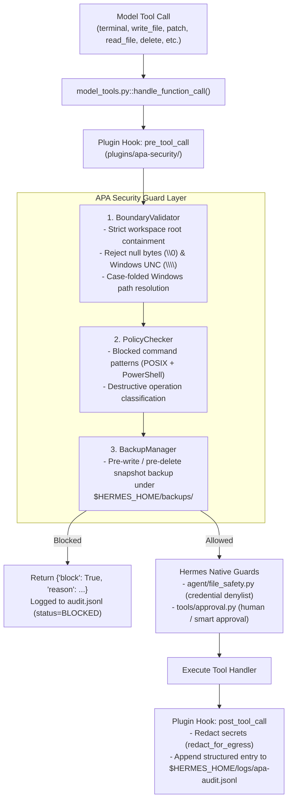

# 10 — Security Analysis & APA Security Guard Architecture

**Project:** APA (Antigravity Personal Agent) — Phase 1 Audit  
**Repository:** `C:\Users\firdaus\APA` (`apa-development`)  
**Scope Authority:** [SECURITY.md](file:///C:/Users/firdaus/APA/SECURITY.md) & Strict Investigation Rules (Section 3 & 11)

---

## 1. Hermes Built-in Security Controls

| Security Domain | File & Line References | Mechanism & Guarantees | Limitations / Gaps |
|---|---|---|---|
| **Credential Protection & Egress Redaction** | [agent/redact.py](file:///C:/Users/firdaus/APA/agent/redact.py#L1-L150), [agent/memory_manager.py](file:///C:/Users/firdaus/APA/agent/memory_manager.py#L89-L144) | Regex + prefix + query-param + vault-value redaction (`redact_sensitive_text`, `redact_for_egress`). Frozen at import (`_REDACT_ENABLED`) so LLM-executed commands cannot disable redaction via `os.environ`. Scrubs logs, tool outputs, and memory provider egress. | Does not write a dedicated structured security audit trail (`audit.jsonl`) for every allowed/blocked file and command action. |
| **OAuth & Secret Isolation** | [hermes_cli/auth.py](file:///C:/Users/firdaus/APA/hermes_cli/auth.py), [agent/secret_scope.py](file:///C:/Users/firdaus/APA/agent/secret_scope.py), [hermes_dir_acl.py](file:///C:/Users/firdaus/APA/hermes_dir_acl.py) | Stores credentials in `get_hermes_home() / "auth.json"` and `.env` with owner-only ACLs (`make_user_dir`). `auth_type="external_process"` delegates auth entirely to the external CLI binary without reading or storing tokens. | None — `auth_type="external_process"` is purpose-built for zero-token-exposure delegation to `agy.exe`. |
| **Dangerous Command Approval** | [tools/approval.py](file:///C:/Users/firdaus/APA/tools/approval.py#L1-L180), `tools/approval_detection.py`, `tools/approval_floors.py` | Multi-layer command gate: hardline blocks, user deny rules, опасные/dangerous command pattern matcher, interactive CLI/gateway prompt (`once`/`session`/`always`/`deny`), smart LLM guardian (`approval_smart.py`), and consecutive-denial circuit breaker (`_denial_tally`, threshold=3). `_YOLO_MODE_FROZEN` prevents runtime env escalation. | Default dangerous command list targets general system destruction; lacks APA's customizable per-workspace `blocked_commands` and pre-deletion backup hooks. |
| **Subprocess Environment Scrubbing** | [tools/environments/local_env_policy.py](file:///C:/Users/firdaus/APA/tools/environments/local_env_policy.py) | Strips Hermes internal secrets, provider API keys (`_HERMES_PROVIDER_ENV_BLOCKLIST`), and plugin-declared secrets before spawning terminal tool subprocesses. Case-folded on Windows (`_ALWAYS_STRIP_FOLDED`). | Custom plugins spawning subprocesses must use the same sanitized environment or explicit allowlists. |
| **File Access Guards** | [agent/file_safety.py](file:///C:/Users/firdaus/APA/agent/file_safety.py#L1-L150) | Denies agent file reads/writes to credential stores (`~/.hermes/auth.json`, `.env`, `mcp-tokens/`, `~/.ssh`, `~/.aws`, sibling profile homes) using case-folded path matching (`deny_key`) on Windows/macOS. | Designed as a *credential-store denylist*, **not** a strict workspace boundary jail (by default, `read_file`/`write_file`/`patch` can access non-credential files outside the current workspace directory). |
| **Git Execution Hardening** | [hermes_cli/_subprocess_compat.py](file:///C:/Users/firdaus/APA/hermes_cli/_subprocess_compat.py#L49-L88) | `harden_git_argv()` injects `--no-ext-diff --no-textconv` and `noninteractive_repo_git_env()` neutralizes malicious `.gitattributes` / `.git/config` diff drivers and hooks. | Applies to internal git probes; agent-invoked `git` commands in `terminal` rely on `approval.py` or plugin hooks. |

---

## 2. Authentication & Antigravity Boundary Compliance

In strict accordance with Section 6 and Section 11:
1. **Official Authentication Only (`APA → AGY → Official Google OAuth → Antigravity`):**
   - APA never extracts, reads, decrypts, or copies OAuth access/refresh tokens from `agy.exe` or `~/.gemini/`.
   - Authentication is initiated solely via `agy login` or `agy acp --login` executed interactively by the user.
2. **Prohibited Practices (Explicitly Rejected):**
   - No manual token extraction or SQLite/keychain scraping.
   - No device identity or `User-Agent` spoofing (`--override_user_agent_name` is never used).
   - No unauthorized CCPA endpoint interception or proxy MITM.
   - No traffic obfuscation.
3. **Subprocess Tool Sandboxing for `agy acp`:**
   - When `agy.exe acp --stdio` is used as a model provider for Hermes, `agy`'s internal tool execution requests (`session/request_permission` or built-in file/bash tools) must be **denied** (`DeniedOutcome`) or run with `--sandbox` so that all tool calls return to Hermes (`model_tools.handle_function_call()`) where Hermes's approval system and APA Security Guard enforce workspace boundaries and user permissions.

---

## 3. APA Security Guard Integration Architecture (`plugins/apa-security/`)

Rather than modifying `model_tools.py` or `agent/file_safety.py`, APA Security Guard integrates cleanly as a first-class Hermes plugin using `pre_tool_call` and `post_tool_call` ([model_tools.py](file:///C:/Users/firdaus/APA/model_tools.py#L794-L817), [hermes_cli/plugins.py](file:///C:/Users/firdaus/APA/hermes_cli/plugins.py#L113-L120)):

### Key Security Controls Enforced by `plugins/apa-security/`
1. **Strict Workspace Boundary (`BoundaryValidator`):**
   - Intercepts `read_file`, `write_file`, `patch`, `search_files`, and `terminal` (`workdir`) calls in `pre_tool_call`.
   - When `strict_boundary: true`, blocks any path resolving outside the active workspace root (with explicit read-only allowlist for `$HERMES_HOME/skills/` and `$HERMES_HOME/memories/`), plus blocks null bytes and Windows UNC paths (`\\server\share`).
2. **PowerShell & POSIX Command Policy (`PolicyChecker`):**
   - Intercepts `terminal` and `execute_code` tool calls in `pre_tool_call`.
   - Blocks catastrophic commands (`format`, `diskpart`, `rmdir /s /q c:`, `Remove-Item -Recurse -Force C:\`, `rm -rf /`, fork bombs) before they even reach `tools/approval.py`.
3. **Automatic Pre-Mutation Backups (`BackupManager`):**
   - Before destructive file overwrites (`write_file` on existing critical files) or memory deletions (`memory` tool `remove`/`replace`), creates a timestamped backup under `get_hermes_home() / "backups"`.
4. **Tamper-Evident Redacted Audit Trail (`AuditLogger`):**
   - In `post_tool_call` (which receives `tool_name`, `args`, `result`, `status`, `error_type`, `duration_ms`, `session_id`, `turn_id`), passes `args` and `result` through `agent.redact.redact_for_egress()` and appends a structured JSONL entry to `get_hermes_home() / "logs" / "apa-audit.jsonl"`.
5. **Fail-Closed Timeout Protection:**
   - Hermes's `_dispatch_pre_tool_call_hooks` ([hermes_cli/plugins_dispatch.py](file:///C:/Users/firdaus/APA/hermes_cli/plugins_dispatch.py#L54-L55)) enforces `_HOOK_CALLBACK_TIMEOUT_SECS` and blocks the tool call (`_PRE_TOOL_CALL_TIMEOUT_BLOCK_MESSAGE`) if a `pre_tool_call` security hook times out.
