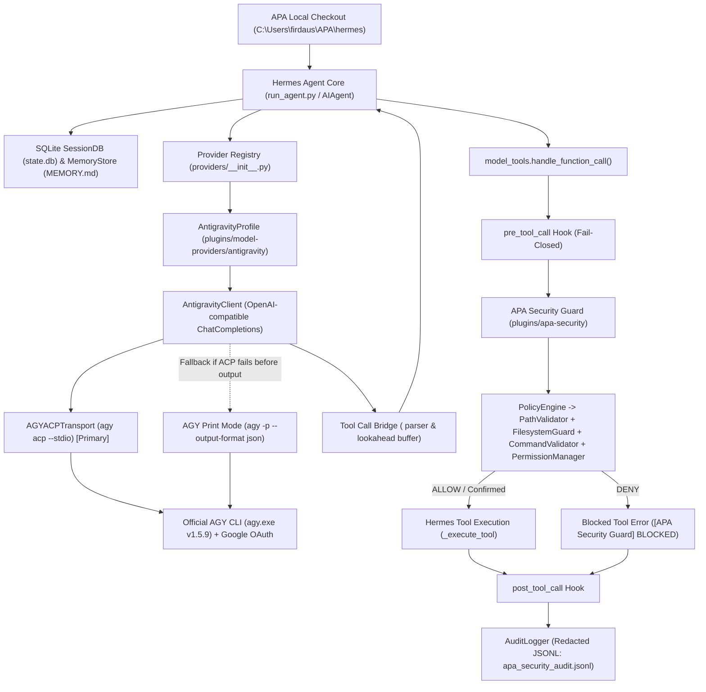

# APA Phase 2.12.9 — Runtime Integration Review

## 1. Executive Summary

This review synthesizes the end-to-end runtime verification of **APA (Antigravity Personal Agent)** running on Windows 10/11 x64 (`C:\Users\firdaus\APA`, branch `apa-development`, Python `3.14.9`).

All three foundational pillars—**Hermes Agent Core**, **Google Antigravity Provider (`plugins/model-providers/antigravity/`)**, and **APA Security Guard (`plugins/apa-security/`)**—have been verified operating together as a single, cohesive runtime without modifying any Hermes Core files or depending on the legacy `D:\Antigravity-Hermes` codebase.

---

## 2. Actual Verified Runtime Architecture

---

## 3. Component Status Classification

| Component | Status | Verification Evidence |
|---|---|---|
| **Local Hermes Runtime (`C:\Users\firdaus\APA`)** | **VERIFIED (`PASS`)** | Boots cleanly under Python `3.14.9`; all core modules resolve to `C:\Users\firdaus\APA`; zero dependency on global Hermes app or `D:\Antigravity-Hermes`. |
| **Plugin Discovery (`PluginManager` & `providers`)** | **VERIFIED (`PASS`)** | Both `apa-security` (`v1.0.0`) and `model-providers/antigravity` (`v1.0.0`) discovered, loaded, and initialized via CLI (`hermes plugins list`) and runtime. |
| **Antigravity Provider (`agy acp --stdio`)** | **VERIFIED (`PASS`)** | Live OAuth check (`AGY CLI ready (1.5.9)`), 18 live models discovered, ACP session creation, incremental streaming, and multi-turn session reuse verified. |
| **Antigravity Fallback (`agy -p`)** | **VERIFIED (`PASS`)** | Controlled ACP failure before output cleanly falls back once to `agy -p --output-format json` (`PRINT_FALLBACK_LIVE_OK`) without duplicate requests. |
| **APA Security Guard (`plugins/apa-security/`)** | **VERIFIED (`PASS`)** | Live interception in `handle_function_call` and `AIAgent.run_conversation()` verified for allowed reads, blocked `.env` reads, outside-workspace access, path traversal, Windows NTFS junctions (`mklink /J`), destructive PowerShell commands, confirmation gates, and redacted JSONL audit logging. |
| **Memory & Session Persistence (`SessionDB` & `MemoryStore`)** | **VERIFIED (`PASS`)** | Active ACP session continuity, SQLite `state.db` persistence across reopened instances, FTS5 search, session isolation, and `MEMORY.md` disk persistence verified. |
| **Subprocess Crash Recovery & Cleanup** | **VERIFIED (`PASS`)** | Terminated `agy.exe` automatically respawns on next request; `client.close()` leaves zero orphan/zombie processes. |
| **Mid-Stream Cancellation (`stream=True`)** | **PARTIALLY VERIFIED (`PARTIAL`)** | `session/cancel` stops generation and preserves session state (`POST_CANCEL_OK`), but `make_stream_chunk` raises `ValidationError` on `finish_reason="cancelled"` (`AGY-STREAM-CANCEL-01`). |
| **Failed / Blocked / Untested Components** | **NONE (`0`)** | All required Phase 2.12 runtime surfaces were tested directly. |

---

## 4. Residual Risks & Bug Summary

1. **Bug `AGY-STREAM-CANCEL-01` (Low Severity, 2-Line Fix Ready)**:
   - *File*: `plugins/model-providers/antigravity/bridge.py:L348` (`make_stream_chunk`).
   - *Cause*: `make_stream_chunk` passes `finish_reason="cancelled"` directly to OpenAI's `ChunkChoice`, whereas `build_chat_completion` (`bridge.py:L296-297`) normalizes non-standard `finish_reason` values to `"stop"` / `"tool_calls"`.
   - *Status*: Documented without modifying source code per Phase 2.12 Section 14 validation-first rule; awaiting user approval to apply the 2-line normalization in `bridge.py`.
2. **In-Workspace Script Execution under Standard Mode**:
   - *Residual Risk*: When `allow_execute=True` and `require_confirmation_for_execute=False`, allowed commands running inside the workspace execute with the OS user's permissions.
   - *Mitigation*: Set `policy_mode: "strict"` or `require_confirmation_for_execute: true` when operating on untrusted repositories.
